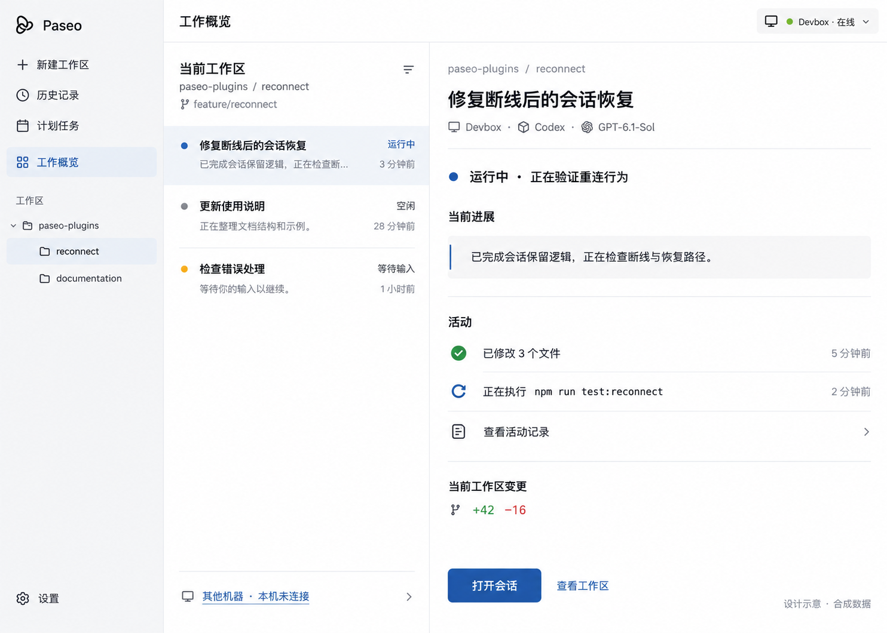
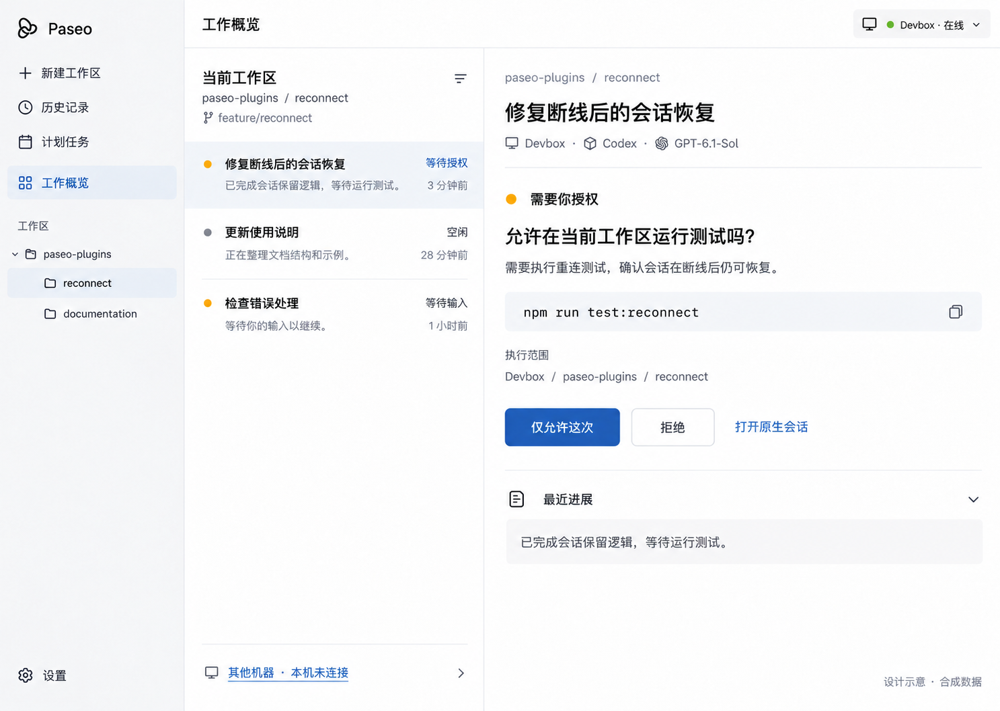
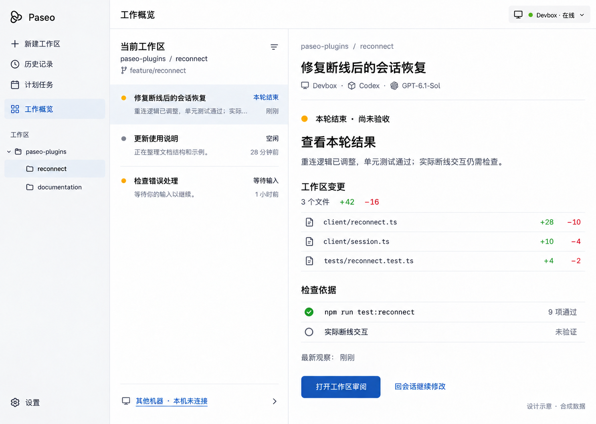

# 已撤回：工作概览三状态图

用户已明确要求只包含既有界面的 UI／UX 变更。本组图引入“工作概览”和结果证据界面，超出范围，已撤回；不再作为实现目标，也不转交其他插件作为隐含交付。原始图、提示词和校验值保留作历史记录。

当前方案见 [UI／UX 范围](../README.md) 与 [交互规格](../interaction-spec.md)。新的原型应直接基于现有会话页优化阅读、工具展开和反馈，不增加业务页面。

## 历史图：运行中

## 历史图：需要介入

## 历史图：审阅与继续

三张图均由内置 ImageGen 生成，使用合成数据，不是成品截图或真实验收。第一张附加有效的 Paseo 官网公开演示截图作为参考，后两张沿用上一张生成图编辑。官网演示不是本机版本的运行证据。一次空白裁切已排除，未用于生成。

完整历史提示词见 [prompts.json](prompts.json)，显示顺序、尺寸与校验值见 [manifest.json](manifest.json)。
