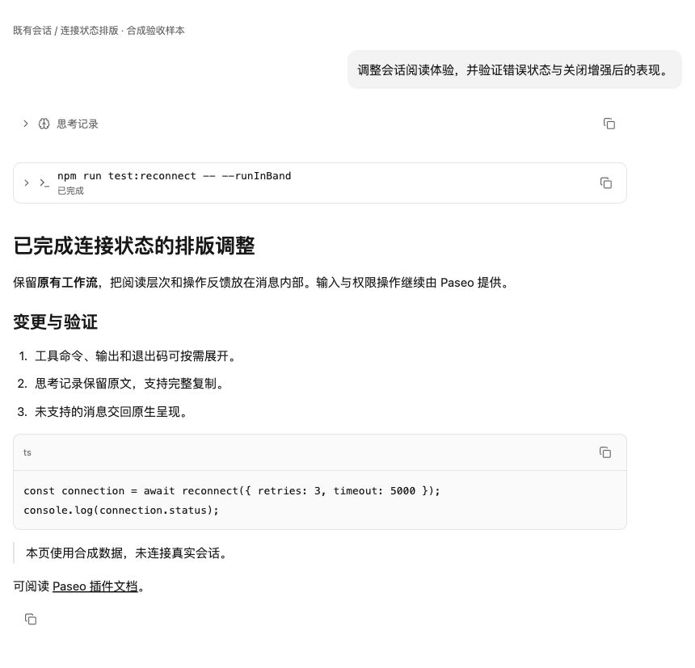

# Codex UI for Paseo

在现有 Paseo 会话中优化阅读、信息层级和展开反馈，保留原生输入框、运行控制、权限处理、侧栏、文件与终端。由原 Codex Theme 扩展而来，保留安装 ID `paseo-codex-theme`、npm 包名和已有的 **Codex Light**／**Codex Dark** 主题 ID。

这是独立插件，与 OpenAI 无隶属关系。全部生产 UI 使用公开插件 API 与 React Native 组件，不注入全局 CSS，不移动原生 DOM，不注册全局快捷键，也不接管业务操作。

## 使用

最低版本为 Paseo `>=0.11.2`，当前运行验收目标为 App／daemon 0.11.4。0.12.0 另作公开声明兼容检查，尚未升级实际客户端。按公开 API 合约设计兼容，能力缺失时释放消息呈现；未知版本仍需运行回归。

```sh
paseo plugin add git:KiritoKing/paseo-plugins --path packages/paseo-codex-theme
```

在设置 → 插件 → Codex UI → 会话外观中选择：

- 过程记录：选择“全部折叠（仅输出）”后隐藏所有工具、思考及其标题，包括流式与失败记录，只保留正文输出。切回“按类别设置”即可恢复之前的显示偏好；原始记录仍保留在会话中。
- 工具：默认保留原生分组。可选逐条记录，支持完整命令、目录、输出、错误、退出码与复制；失败默认展开。
- 思考：默认折叠，保留全文、选择和复制。
- 正文：支持常见 Markdown、代码块、字号、密度与阅读宽度。
- 代码：横向阅读或自动换行，长内容在有界区域滚动，完整复制不受展示高度限制。

正文流式输出由原生处理，完成后才考虑自定义排版。图片、附件、HTML、表格、任务列表、文件／相对链接、未知字段与超限内容不被接管。工具只呈现能够完整理解的 shell 记录，专用工具保持原生。开启逐条工具样式后，匹配的记录会脱离原生命令聚合，因此该选项默认关闭。关闭总开关即可释放全部呈现；按类别设置时，也可关闭对应类别。仅输出模式会统一过滤工具与思考，切回按类别设置可释放该过滤；同类消息不应同时启用两个呈现插件。图片消息保持原生，以保留已有媒体插件的工作方式。

配色独立可选：在设置 → 外观选择 Codex Light 或 Codex Dark，安装不会自动切换当前主题。偏好保存在当前 host，支持原生设置的版本校验与冲突反馈。



截图来自真实 React Native Web 组件夹具，使用合成数据并开启可选工具样式。它不表示移动端或特定宿主版本的完整验收；开发阶段验证记录仅保存在源码仓库中。

## 开发

从 monorepo 根目录使用仓库固定的 pnpm 版本执行：

```sh
pnpm install --frozen-lockfile --ignore-scripts
pnpm --filter @chlrc/paseo-codex-theme typecheck
pnpm --filter @chlrc/paseo-codex-theme test
pnpm fixtures:serve
```

浏览器夹具复用仓库的构建与服务入口，在 `/conversation-ui.html` 打开。服务默认端口为 8769，可用 `PORT` 指定空闲端口；终止命令即释放服务。夹具使用真实呈现组件与合成数据，替代 host API 的部分仅用于组件验收，不能代替原生 Paseo 集成验收。

`shared/vendor/marked.js` 为固定版本 Marked 18.1.1 的可审查构建，许可证与源文件 SHA-256 同目录保存。更新该依赖后运行 `pnpm --filter @chlrc/paseo-codex-theme build:markdown` 并提交生成文件。插件包不需要在用户机器上安装额外运行时依赖；React、React Native、Zod 与 Paseo SDK 由宿主提供。

服务端仅注册原生偏好设置，不订阅 agent 生命周期、不执行 shell、不读取 Git，也不新增业务 RPC。客户端卸载时释放其设置订阅、transformer、renderer、设置入口和主题。
